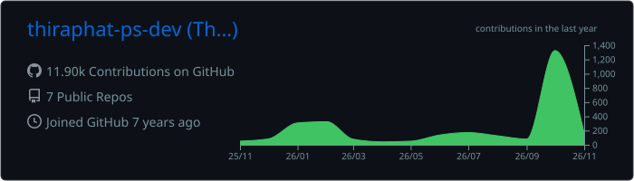

<h1 align="center">Hi there! 👋 I'm Thiraphat</h1>

  <b>Senior Frontend Developer</b> · React · TypeScript · Next.js 
  I build clean, fast, user-friendly interfaces — and tinker with games, trading bots, and AI agents on the side ✨

  
  

---

### 🧠 About Me

- 🔭 Working as a **Senior Frontend Developer**
- ✍️ Writing about frontend craft, team workflow, and engineering mindset on [Medium](https://medium.com/@thiraphat-ps-dev)
- 💬 Ask me about **React, Next.js, TypeScript, design systems, clean code**
- 📚 Love building **UI components, developer tools, and automation**
- 🌱 Currently exploring **AI agents** and **game development with TypeScript**

### 🚧 Currently Building

- 🗡️ **Nine Swords** — a pixel isometric wuxia MMORPG, written in TypeScript
- 📈 **AlgoSense AI** — AI-assisted algorithmic trading with real-time analysis and risk management
- 🤖 **Agentic Workspace** — tooling for working alongside AI coding agents

---

### 🛠️ Tech Stack

**Frontend** 

**Backend & Tools** 

---

### 📌 Featured Projects

| Project | Description | Stack |
|---|---|---|
| [InventoryManagementSystem](https://github.com/thiraphat-ps-dev/InventoryManagementSystem) | Full-stack inventory management system | Django · Next.js |
| [ts-utility-stash](https://github.com/thiraphat-ps-dev/ts-utility-stash) | Type-safe TypeScript utility library, bundled with Rollup and tested with Jest | TypeScript |
| [head-hot-cms](https://github.com/thiraphat-ps-dev/head-hot-cms) | Headless CMS built on Payload 3 with Docker and Playwright tests | Payload · Next.js 15 |
| [typescript-automation-project](https://github.com/thiraphat-ps-dev/typescript-automation-project) | Fully automated TS setup — lint, test, build, deploy via GitHub Actions | TypeScript · CI/CD |
| [binance-trading-bot](https://github.com/thiraphat-ps-dev/binance-trading-bot) | Automated trading bot for Binance | Python |

---

### ✍️ Latest Articles

<!-- BLOG-POST-LIST:START -->
<!-- BLOG-POST-LIST:END -->

➡️ [More articles on Medium](https://medium.com/@thiraphat-ps-dev)

---

### 📊 GitHub Stats

  

  
  

  

---

### 📫 Connect with Me

<i>⭐️ Thanks for stopping by! Let's build something amazing together.</i>

