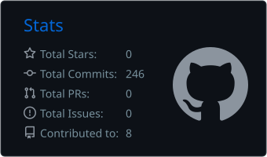
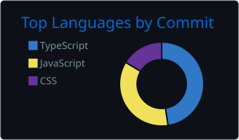

  

<h1 align="center">Hi there! 👋 I'm Thiraphat</h1>

  <b>Senior Frontend Engineer</b> · Bangkok · React · TypeScript · Next.js 
  I build scalable, accessible interfaces, plus the design systems and teams behind them. On the side I tinker with games, trading bots and AI agents ✨

  
  
  
  

---

### 🧠 About Me

- 🔭 Senior Frontend Engineer, leading frontend for membership and e-commerce platforms
- ✍️ Writing about frontend craft, team workflow, and engineering mindset on [Medium](https://medium.com/@thiraphat-ps-dev)
- 💬 Ask me about **React, Next.js, TypeScript, design systems, clean code**
- 📚 Love building **UI components, developer tools, and automation**
- 🌱 Currently exploring **AI agents** and **game development with TypeScript**

### 🚧 Currently Building

- 🎨 **[thira-ui](https://github.com/thiraphat-ps-dev/thira-ui)**: my accessible React UI library, now on [npm](https://www.npmjs.com/package/thira-ui) ([live demo](https://thiraphat-ps-dev.github.io/thira-ui/))
- 🌐 **[My portfolio](https://thiraphat-ps-dev.github.io/)**: product-launch-style scroll storytelling built with Astro + thira-ui, pure CSS scroll-driven animations
- 🔤 **[Thira Sans](https://github.com/thiraphat-ps-dev/thira-sans)**: my own Thai + Latin variable font, forked from Anuphan (OFL) and being redesigned ([proof page](https://thiraphat-ps-dev.github.io/thira-sans/))
- 🌧️ **[Lofi Room](https://github.com/thiraphat-ps-dev/lofi-room)**: full-screen pixel-art scenes for listening to lofi, drawn in code on a canvas ([open the room](https://thiraphat-ps-dev.github.io/lofi-room/))
- ⌨️ **[Touch Type](https://github.com/thiraphat-ps-dev/touch-type)**: learn to touch type in Thai (Kedmanee) and English, with weak-key drills ([start typing](https://thiraphat-ps-dev.github.io/touch-type/))
- 📡 **[Pulseboard](https://github.com/thiraphat-ps-dev/pulseboard)**: uptime monitoring with Discord/Slack alerts and a public status page, on Cloudflare Workers + D1 ([live status](https://pulseboard.thira-web.workers.dev/s/thiraphat-ps-dev))
- 🗡️ **Nine Swords** — a pixel isometric wuxia MMORPG, written in TypeScript
- 📈 **AlgoSense AI** — AI-assisted algorithmic trading with real-time analysis and risk management
- 🤖 **Agentic Workspace** — tooling for working alongside AI coding agents

---

### 🛠️ Tech Stack

**Frontend** 

**Backend & Tools** 

---

### 📌 Featured Projects

| Project | Description | Stack |
|---|---|---|
| 🎨 [**thira-ui**](https://github.com/thiraphat-ps-dev/thira-ui) · [demo](https://thiraphat-ps-dev.github.io/thira-ui/) · [npm](https://www.npmjs.com/package/thira-ui) | Accessible React component library (12 components) built on Base UI primitives. Modern CSS with `@layer` and `oklch()` tokens, axe-checked Storybook, strict CI, tag-based npm releases | React 19 · TypeScript · CSS |
| 🌐 [**Portfolio**](https://thiraphat-ps-dev.github.io/) · [source](https://github.com/thiraphat-ps-dev/thiraphat-ps-dev.github.io) | Scroll storytelling with an exploded 3D layer view, a scroll-driven theme spectrum and a zoom-through outro. All CSS scroll-driven animations, no animation JS | Astro · thira-ui · CSS |
| 🔤 [**Thira Sans**](https://github.com/thiraphat-ps-dev/thira-sans) · [proof](https://thiraphat-ps-dev.github.io/thira-sans/) · [npm](https://www.npmjs.com/package/thira-sans) | Thai + Latin variable sans-serif (weight 100–700), forked from Anuphan under the OFL. Builds TTF, OTF and woff2 in CI and deploys a Thai proof page | Glyphs · gftools · CI |
| 🌧️ [**Lofi Room**](https://github.com/thiraphat-ps-dev/lofi-room) · [live](https://thiraphat-ps-dev.github.io/lofi-room/) | Five animated pixel-art scenes (rainy room, seaside, snowy cabin, neon city, campfire) drawn on a canvas with no image files. YouTube stations, Web Audio rain and a focus timer | Canvas 2D · Web Audio · JS |
| ⌨️ [**Touch Type**](https://github.com/thiraphat-ps-dev/touch-type) · [live](https://thiraphat-ps-dev.github.io/touch-type/) | Thai + English touch-typing lessons row by row. Keys read by position (no system keyboard switch), Thai-aware cursor, weak-key drills, timed test and per-key heatmap | React · TypeScript · thira-ui |
| 📡 [**Pulseboard**](https://github.com/thiraphat-ps-dev/pulseboard) · [live status](https://pulseboard.thira-web.workers.dev/s/thiraphat-ps-dev) | Multi-user uptime monitor. A cron Worker checks sites every minute, confirms outages before opening incidents, alerts on Discord/Slack and publishes 90-day status pages. PBKDF2 auth, hashed sessions, SSRF guard | Cloudflare Workers · D1 · Hono · React · thira-ui |

---

### ✍️ Latest Articles

<!-- BLOG-POST-LIST:START -->
- 📝 [4 วัน 140 commits กับ Claude Code: ทำอะไรได้บ้าง และตรงไหนที่ยังต้องใช้คน](https://thiraphat-ps-dev.medium.com/4-%E0%B8%A7%E0%B8%B1%E0%B8%99-140-commits-%E0%B8%81%E0%B8%B1%E0%B8%9A-claude-code-%E0%B8%97%E0%B8%B3%E0%B8%AD%E0%B8%B0%E0%B9%84%E0%B8%A3%E0%B9%84%E0%B8%94%E0%B9%89%E0%B8%9A%E0%B9%89%E0%B8%B2%E0%B8%87-%E0%B9%81%E0%B8%A5%E0%B8%B0%E0%B8%95%E0%B8%A3%E0%B8%87%E0%B9%84%E0%B8%AB%E0%B8%99%E0%B8%97%E0%B8%B5%E0%B9%88%E0%B8%A2%E0%B8%B1%E0%B8%87%E0%B8%95%E0%B9%89%E0%B8%AD%E0%B8%87%E0%B9%83%E0%B8%8A%E0%B9%89%E0%B8%84%E0%B8%99-ca4a37f38ef7?source=rss-9e52e66ee713------2) · Nov 18, 2026
- 📝 [4 Days, 140 Commits with Claude Code: What It Did and Where It Still Needed Me](https://thiraphat-ps-dev.medium.com/4-days-140-commits-with-claude-code-what-it-did-and-where-it-still-needed-me-a3bc4b0c0b66?source=rss-9e52e66ee713------2) · Nov 18, 2026
- 📝 [ปัดมุมทุกมุมของ Variable Font ด้วย Script: บทเรียนจาก Thira Sans](https://thiraphat-ps-dev.medium.com/%E0%B8%9B%E0%B8%B1%E0%B8%94%E0%B8%A1%E0%B8%B8%E0%B8%A1%E0%B8%97%E0%B8%B8%E0%B8%81%E0%B8%A1%E0%B8%B8%E0%B8%A1%E0%B8%82%E0%B8%AD%E0%B8%87-variable-font-%E0%B8%94%E0%B9%89%E0%B8%A7%E0%B8%A2-script-%E0%B8%9A%E0%B8%97%E0%B9%80%E0%B8%A3%E0%B8%B5%E0%B8%A2%E0%B8%99%E0%B8%88%E0%B8%B2%E0%B8%81-thira-sans-1b62c21be766?source=rss-9e52e66ee713------2) · Nov 18, 2026
- 📝 [Rounding Every Corner of a Variable Font with a Script: Lessons from Thira Sans](https://thiraphat-ps-dev.medium.com/rounding-every-corner-of-a-variable-font-with-a-script-lessons-from-thira-sans-89b53b67afb7?source=rss-9e52e66ee713------2) · Nov 16, 2026
- 📝 [Dogfooding UI Library ของตัวเอง: สร้าง Portfolio แบบ Scroll-Driven ด้วย CSS ล้วน](https://thiraphat-ps-dev.medium.com/dogfooding-ui-library-%E0%B8%82%E0%B8%AD%E0%B8%87%E0%B8%95%E0%B8%B1%E0%B8%A7%E0%B9%80%E0%B8%AD%E0%B8%87-%E0%B8%AA%E0%B8%A3%E0%B9%89%E0%B8%B2%E0%B8%87-portfolio-%E0%B9%81%E0%B8%9A%E0%B8%9A-scroll-driven-%E0%B8%94%E0%B9%89%E0%B8%A7%E0%B8%A2-css-%E0%B8%A5%E0%B9%89%E0%B8%A7%E0%B8%99-ea4725a72618?source=rss-9e52e66ee713------2) · Nov 15, 2026<!-- BLOG-POST-LIST:END -->

➡️ [More articles on Medium](https://medium.com/@thiraphat-ps-dev)

---

### 📊 GitHub Stats

  

  
  

  

---

### 📫 Connect with Me

<i>⭐️ Thanks for stopping by! Let's build something amazing together.</i>

